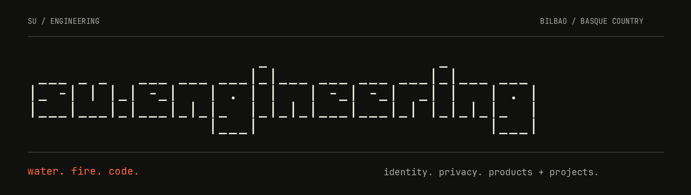

### We design and build software for hard technical problems.

su.engineering is an independent product & engineering studio in **Bilbao, Basque Country**. We help companies, system integrators, enterprise teams and research consortia design and ship technically difficult software.

**Identity · Privacy · AI · Security · Distributed systems**

#### project work

- **[Identity & EUDI](https://su.engineering/project-work/identity)**: wallets, issuers, verifiers, credentials and interoperability.
- **[Product Engineering](https://su.engineering/project-work/product-engineering)**: from ambitious technical idea to working product.
- **[Specialist Partner](https://su.engineering/project-work/partners)**: senior engineering capability inside your existing project.

We stay small and senior, and build the team around the problem: from one specialist to a full delivery team. Our team brings experience from **30+ enterprise projects**, including work before founding su.engineering.

#### products

We build what we advise on.

| Product | Status | What it is |
| :--- | :--- | :--- |
| [**Velum**](https://velumprivacy.com) | Live | Privacy infrastructure for everyday AI workflows. Keeps sensitive information from being exposed to AI tools and other external services. |
| [**OpenKYC**](https://openkyc.org) | Approaching launch | Reusable identity verification without repeating KYC. Credential-based identity and age verification built on reusable proofs. |
| [**REM**](https://reconciled.dev) | In development | Shared engineering memory for teams working with AI agents, across developers, repositories and coding tools. |
| [**Klangfarbe**](https://klangfarbe.su.engineering) | In development | Verifiable identity for AI voice agents. An open protocol that lets the receiver of a call check which organization's agent is speaking and for what purpose. |

#### open source

- [**keycloak-oid4vp**](https://github.com/su-engineering/keycloak-oid4vp): OpenID4VP wallet login for Keycloak. Verifies SD-JWT VC and mDoc presentations, with issuer trust from X.509 and ETSI trust lists, did:web or did:webvh.
- [**eudi-disclosure-policy**](https://github.com/su-engineering/eudi-disclosure-policy): checks that an OpenID4VP request asks only for the data its purpose needs, before a verifier sends it to an EUDI Wallet. TypeScript library and CLI.
- [**awesome-eudi**](https://github.com/su-engineering/awesome-eudi): a curated index of the European Digital Identity Wallet ecosystem: regulation, the ARF, the specifications and the implementations.
- [**heic-web**](https://github.com/su-engineering/heic-web): HEIC decoding and conversion for web applications, in browsers where native support is limited or inconsistent. On npm as [`@su-engineering/heic`](https://www.npmjs.com/package/@su-engineering/heic).
- [**react-native-nearby-interaction**](https://github.com/su-engineering/react-native-nearby-interaction): Apple's Nearby Interaction framework for React Native and Expo apps.

#### academy

[Digital Identity 101](https://academy.su.engineering/courses/digital-identity-101) is a free, plain-English course on digital identity wallets, eIDAS 2 and the EUDI Wallet: 16 short lessons, ending in a verifiable certificate. All courses: [academy.su.engineering](https://academy.su.engineering).

#### writing

[Engineering notes](https://su.engineering/writing) from actual work: digital identity and EUDI, privacy engineering, AI systems, security, distributed systems and product engineering.

---

**Bring us the hard part.** [Discuss a project](https://su.engineering/contact) or write to [hello@su.engineering](mailto:hello@su.engineering).

[Website](https://su.engineering) · [Expertise](https://su.engineering/expertise) · [Writing](https://su.engineering/writing) · [Academy](https://academy.su.engineering) · [LinkedIn](https://www.linkedin.com/company/su-engineering/) · [RSS](https://su.engineering/feed.xml)

"su" means water in Turkish and fire in Basque.
